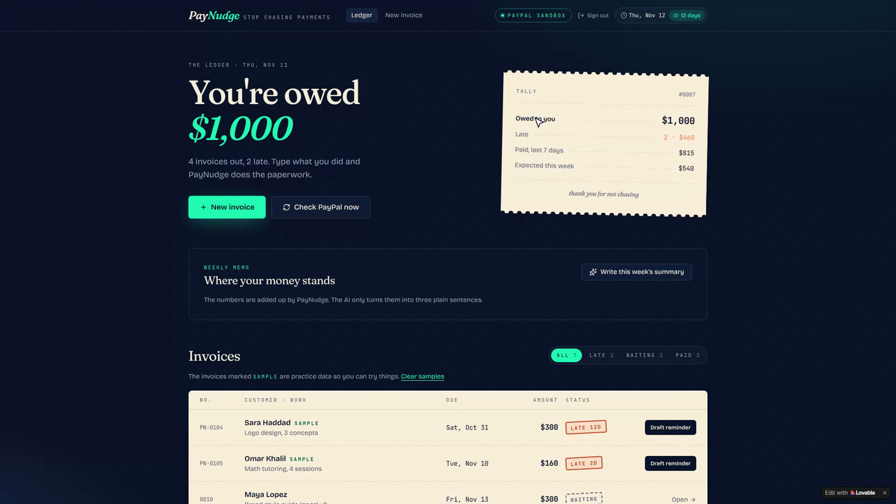
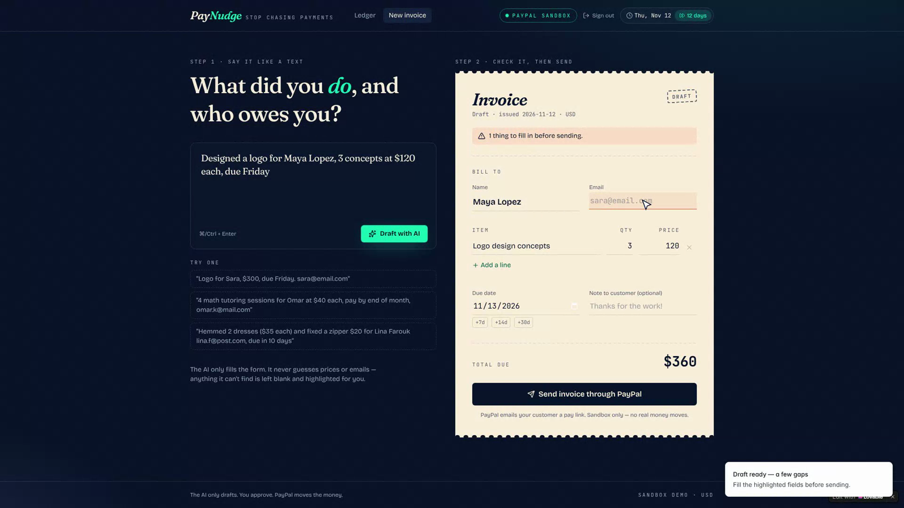
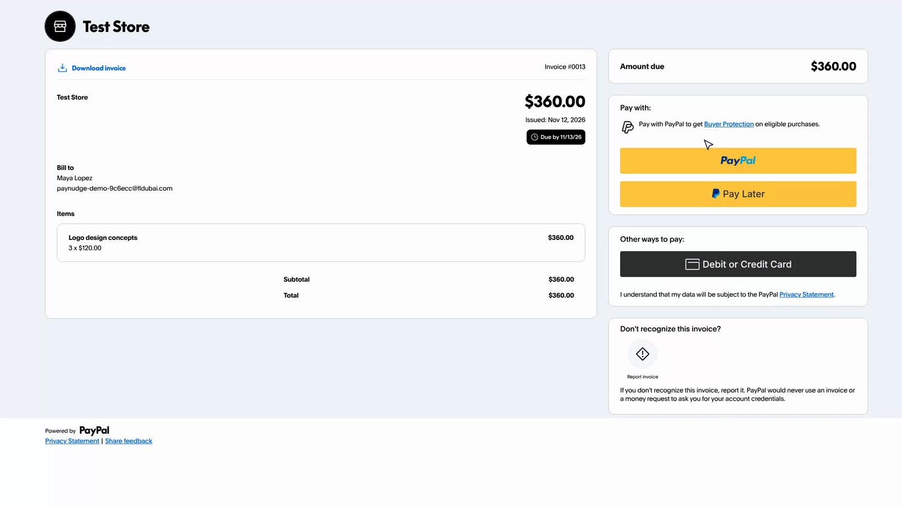
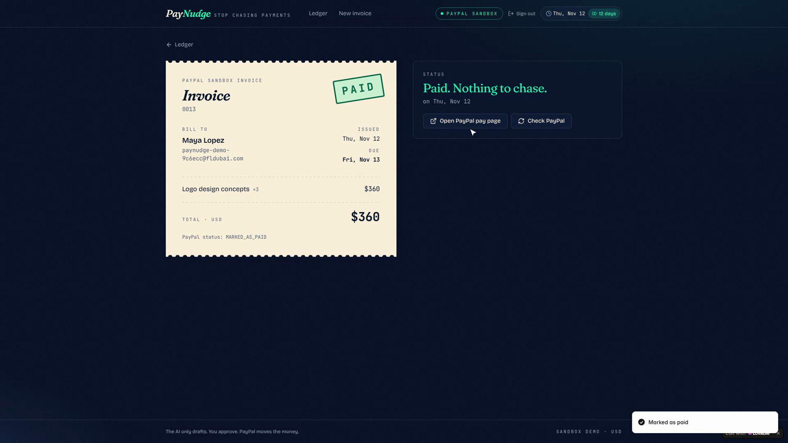
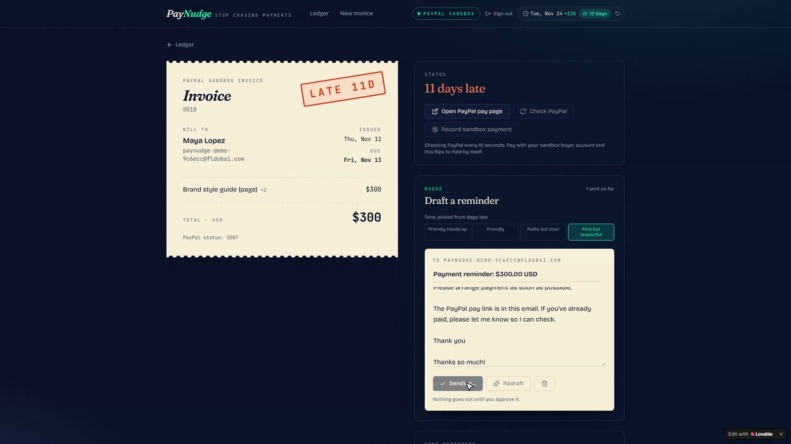
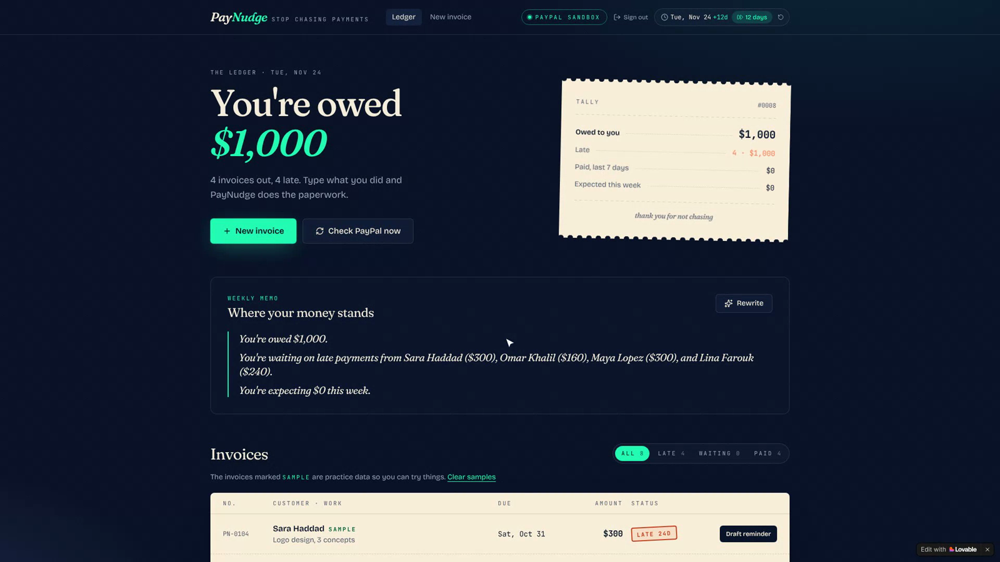

# PayNudge — stop chasing payments

**An AI assistant for freelancers and small sellers that turns a quick message into a PayPal invoice, then nudges late payers politely until the money arrives.**

Built for the **PayPal AI Hackathon 2026**. Runs on the **PayPal sandbox** — no real money moves.

- **Live demo:** https://lovable.dev/preview/GAEKtsPQCu7mubUnwp1AKcZm9Zmjryzn
- **Demo video:** `<ADD YOUR YOUTUBE LINK>`



| Message → invoice | Real PayPal sandbox invoice | Paid, automatically |
|---|---|---|
|  |  |  |

| Tone-matched reminder you approve | Weekly summary |
|---|---|
|  |  |

## The problem

Freelancers do the work, then spend hours writing invoices and awkward "gentle reminder" emails — and still lose track of who owes what. PayPal can send invoices, but it doesn't help you write them, decide when to chase, or say how to word it.

## What PayNudge does

1. **Message to invoice.** Paste something like *"Designed a logo for Maya Lopez, 3 concepts at $120 each, due Friday"*. The AI extracts the customer, line items and due date. Anything it can't find (here, the email) is **flagged as missing instead of guessed**.
2. **Send through PayPal.** The invoice is created and sent with the **PayPal Invoicing API v2**. The customer pays on PayPal's own page.
3. **Know who is late.** The dashboard shows what you're owed, what's late and what's expected this week.
4. **Polite reminders that fit the situation.** The AI drafts a reminder in a tone picked by code from days late — friendly heads-up → friendly → polite but clear → firm but respectful. You edit and approve it; PayPal sends it with the pay link.
5. **Status updates itself.** A signature-verified PayPal webhook (with a 10-second polling backup) flips an invoice to **Paid** the moment it's paid.
6. **Weekly summary.** Code adds up the numbers; the AI turns them into three plain sentences.
7. **Demo clock.** Jump 12 days ahead to show late invoices and the change in reminder tone without waiting.

## AI does the words, code does the numbers

The model never computes money or dates. This is the core design rule.

| Done by AI | Done by code (`src/lib/paynudge/logic.ts`) |
| --- | --- |
| Reading a messy message into invoice fields | Totals, rounding, due dates, days late |
| Writing reminder wording | Choosing the reminder **tone** from days late |
| Turning numbers into 3 summary sentences | Every number in the weekly summary |

Code also double-checks the AI: an email address or price that doesn't literally appear in the user's message is discarded and marked missing (`parseInvoiceMessage` in `src/lib/paynudge/paynudge.functions.ts`). Reminder prompts forbid threats, late fees, legal claims and invented facts, and nothing is sent without the seller pressing **Approve & send**.

## PayPal integration

- **Invoicing API v2:** generate invoice number, create, send, remind, fetch status, record payment.
- **Idempotency:** create / send / payment calls carry a `PayPal-Request-Id`.
- **Webhook** (`/api/public/paypal/webhook`): verifies the signature with PayPal (`/v1/notifications/verify-webhook-signature`), never trusts the request body, re-fetches the invoice from PayPal, then updates the database.
- **Server-side amounts:** the amount recorded for a sandbox payment always comes from the invoice's amount due on PayPal, never from the browser.

## Security

- Every server function that touches data requires a signed-in user, and PayPal invoice IDs are checked against the caller's own rows before any action.
- Row Level Security on every table (`drizzle/migrations/`); the public pay page only exposes a single invoice by its unguessable ID.
- All inputs validated with zod (lengths, ranges, formats).
- Secrets live only in server environment variables — none are in this repo (see `.env.example`).

## Tech stack

TanStack Start (React 19, TypeScript) · Tailwind CSS v4 · shadcn/ui · Supabase via Lovable Cloud (Postgres + auth + RLS) · PayPal Invoicing API v2 + Webhooks · Lovable AI gateway (structured JSON output) · Vitest · GitHub Actions CI

```
src/
  routes/                         pages: dashboard, new invoice, invoice detail, pay page, auth
  routes/api/public/paypal/webhook.ts   signed PayPal webhook
  lib/paynudge/
    logic.ts                      business rules (dates, tone, totals, summary numbers)
    logic.test.ts, logic.rules.test.ts   unit tests for those rules
    paynudge.functions.ts         server functions (AI jobs + PayPal actions)
    store.ts                      client cache of the user's invoices/reminders
  server/
    ai.server.ts                  structured-output AI helper (server only)
    paypal.server.ts              PayPal API helper (server only)
drizzle/migrations/               database schema + RLS policies
```

## Run it locally

Requires [Bun](https://bun.sh) (or Node.js ≥ 20.19 with npm).

```sh
bun install
cp .env.example .env     # then fill in your values
bun run dev              # http://localhost:3000
```

Quality checks (the same ones CI runs):

```sh
bun run lint
bun run typecheck
bun run test             # 26 unit + routing tests
bun run build
```

### Environment variables

See [`.env.example`](.env.example). Server-only secrets: `SUPABASE_SERVICE_ROLE_KEY`, `LOVABLE_API_KEY`, `PAYPAL_API_KEY`, `PAYPAL_WEBHOOK_ID`. The `VITE_*` values are public by design (they are shipped to the browser).

### PayPal sandbox setup

1. In the [PayPal Developer Dashboard](https://developer.paypal.com), use a sandbox **Business** account (the seller) and a **Personal** account (the buyer).
2. Connect the sandbox business account through the Lovable PayPal connector and set `PAYPAL_API_KEY`.
3. Add a webhook pointing to `https://<your-domain>/api/public/paypal/webhook`, subscribe to `INVOICING.INVOICE.PAID` (and the other invoice events), and put its ID in `PAYPAL_WEBHOOK_ID`.

Without PayPal credentials the app runs in **practice mode** with local pay pages (no PayPal calls).

## Try it in 60 seconds

1. Open the live demo and create an account (email or Google).
2. Click **New invoice**, paste a message, review the draft, and send it through PayPal.
3. Open the PayPal pay page as the sandbox buyer and pay — or use **Record sandbox payment** — and watch the invoice flip to **Paid**.
4. Click **12 days** in the header to make an invoice late, then draft, edit and approve a reminder.
5. Back on the dashboard, click **Write this week's summary**.

## Honest limitations

- **Sandbox only.** Invoices go to PayPal's sandbox environment; USD only.
- **"Record sandbox payment" is a demo shortcut.** It records a payment on the PayPal invoice so you can demo without a second account. In a real flow the buyer pays on PayPal's page and the webhook marks it paid.
- **Built with [Lovable](https://lovable.dev).** At runtime it uses Lovable Cloud (Supabase database and auth), the Lovable AI gateway and the Lovable PayPal connector gateway. To run it elsewhere, swap those three pieces (`src/server/ai.server.ts`, `src/server/paypal.server.ts`, Supabase config).

## License

MIT — see [LICENSE](LICENSE).
